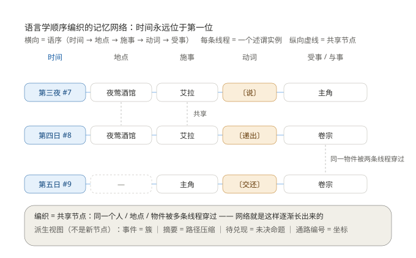
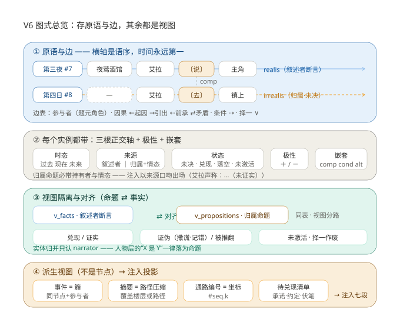
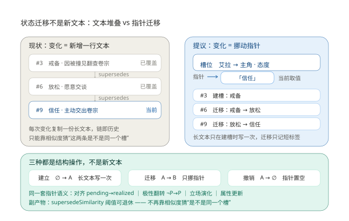

# 动词层与命题层设计 (V6) —— 存原语与边，其余都是视图

> 状态: **设计草案，未实现**。动表结构前需先评审本文件。
> 前置阅读: `docs/database-design-v2.md`(语义实体层) / `docs/injection-tables.md`(图视角与注入表格化)

---

## 1. 缘起与核心命题

本轮设计由四轮讨论递进而来 (2026-10-13)，用户逐步把架构推向同一个方向:

1. **事件是模糊的** —— "事件"不是一个语言原语，它是"谁—做了什么—对谁—何时何地—结果如何"的打包，所以必然无法定义清楚。
2. **动词才是原语** —— 引入语言学视角: 谓语是枢纽，施事/受事/与事/时间/地点是题元角色。
3. **事件应降级为派生簇** —— 同一时间节点 + 共享参与者 + 一组动词实例 + 状态变化，涌现出一个"事件"。
4. **从句客观存在但真值不归叙述者** —— "艾拉说昨天她去买菜了": 从句内容可能为真、可能撒谎、可能记错。

**核心命题（本文件的全部内容都由这一句推出）**:

> **存原语与边，其余都是视图。**

推论:
- 摘要是**路径压缩视图**（覆盖一段楼层/路径区间的物化快捷键，可从图重算）
- 事件是**簇视图**（时间节点 + 参与者 + 实例 + 状态变化）
- 通路编号是**坐标标签**（`#<timeSeq>.<k>`，k = 节点内实例序，确定性派生）
- 待兑现/未证实清单是**未决命题视图**
- 状态迁移（否→是、A→B）是**指针移动 + 迁移记录**，不是新文本 —— 见 §16（前提：目标元素已在网中）

### 1.1 图示

**图 1 —— 语序读法（原语如何编织成网）**



读法:
- **横向 = 语序**（时间 → 地点 → 施事 → 动词 → 受事/与事）。**时间永远在第一位**，是每一条线程的起点。
- **每条线程 = 一个述谓实例**。动词列（琥珀色）是本方案补上的那个一直缺失的槽位。
- **纵向虚线 = 共享节点**：同一个人 / 地点 / 物件被多条线程穿过。**网络就是这样逐渐长出来的**——不需要"建事件"，只需要新线程穿过已有节点。
- **空槽（"—"）= 题元槽可空**：不是所有实例都有地点。

**图 2 —— 图式总览（本方案的全貌）**



四层读法:

| 层 | 内容 | 对应本文档 |
|---|---|---|
| ① 原语与边 | 实线线程 = 叙述者断言；**虚线线程 = 归属命题（未然）**，与父实例以 `comp` 相连；边表统一（参与者 / 因果 / 条件 ⇢ / 择一 ∨） | §3 §4.3 |
| ② 实例字段 | 三根正交轴（时态 / 来源 / 状态）+ 极性 + 嵌套（comp·cond·alt） | §4.1 §5 |
| ③ 视图隔离与对齐 | `v_facts` ⇄ `v_propositions`（同表分路）；对齐四态：兑现 / 证实 / 证伪（撒谎·记错）/ 被推翻；未激活 · 择一作废 | §6 §7.1 |
| ④ 派生视图 | 事件 = 簇 ｜ 摘要 = 路径压缩 ｜ 通路编号 = 坐标 ｜ 待兑现清单 —— **都不是节点**，最终投影到既有注入七段 + 新增【待兑现】段 | §10 |

两条贯穿全图的硬规则（写在图上）:
- **归属命题必带持有者与情态**，注入以来源口吻出场（`艾拉声称：…（未证实）`）—— §4.4
- **实体归并只认 `narrator`**，人物层的"X 是 Y"一律落为命题 —— §5.3

---

## 2. 为什么"事件"这个类型不成立（证据）

不是审美问题，是现存的三处实证:

**证据 1：抽取判据是自白式的。**
`extractionService.SYSTEM_PROMPT` 里写着:

> 判断标准: 去掉这条事件, 剧情会不会少一个因果环节。会 -> 建; 不会 -> 不建。
> 反例: "艾拉去小卖部"、"两人吃晚饭"、"主角睡下" —— 这些不是叙事事件。

**需要靠这种判据才能定义的类型，就是分类不可判定的证据。** 而"谁—动词—谁"的抽取是 LLM 最稳的活。

**证据 2：信息正交性必须靠纪律维持。**
`docs/injection-tables.md §4.6` 要求事件正文禁止写时间/人物/地点，靠 prompt 硬约束（"反例: 暴雨第三夜主角与艾拉在酒馆初遇"）。**这是靠纪律去做本可以靠结构保证的事**——如果时间/人物/地点是题元槽，正文里没有地方写它们。

**证据 3（最严重）：现在有两种静默的失败模式。**
抽取 prompt 要求"只抽取文本中明确出现或强烈暗示的信息"，于是 "艾拉说明天去镇上买草药" 只有两个归宿:

| 归宿 | 后果 |
|---|---|
| 整句丢弃 | **伏笔消失** —— 承诺/计划/悬而未决的线索全丢 |
| 抽成事件"去镇上买草药" | **把意图写成事实** —— 模型下轮当真事用 |

第二种更危险: 它是**反向吃书**——不只旧设定被覆盖，还有"没发生的事被当成发生了"，而且静默。

---

## 3. 语言学基础：题元结构

采用题元语法（case grammar / FrameNet）的基本框架: **谓语是枢纽，题元角色是它的边**。

| 题元槽 | 示例 | 现有 schema 已有什么 |
|---|---|---|
| 施事 Agent | 艾拉说了… | `event_participants.role` = 发起者（**已是题元角色**，且主键含 role，同一人可多角色） |
| 受事 Patient | 递出卷宗 | 同上 = 对象 |
| 与事 Recipient | 说给主角 | 同上 = 参与者 |
| 时间 Time | 第三夜 | `events.time_id` → `time_points(chat_id, label, seq)`（**已是题元槽**） |
| 地点 Place | 夜莺酒馆 | `events.location_id` |
| 结果 Result | 立场变了 | `attribute_chunks` / `stances` 的 supersedes 演化（**已能表达 delta**） |
| **动词 Predicate** | **说 / 递出 / 买** | ❌ **缺** —— 埋在 `title` / `process` 的自由文本里 |

**结论: 这不是"新增一个元素类型"，而是把已经埋在文本里的那个原语提出来做成显式槽位。** 改动量比直觉小得多。

---

## 4. 原语模型：命题（述谓实例）

### 4.1 三根正交轴

初版设计（我）曾把轴定为 realis / irrealis 二元，被用户反例打穿: "艾拉说**昨天**她去买菜了"这个从句指向过去，不是"未然"。

**修正后的模型——真值担保来源与时间位置正交:**

| 轴 | 取值 | 决定什么 |
|---|---|---|
| ① 时态定位 | 过去 / 现在 / 未来 | 只决定"到没到点"（对齐的时间窗口） |
| ② 担保来源 | 叙述者断言 ｜ 归属给某人（说/认为/相信/希望/怀疑/假装/不知） | **真值归谁** —— 撒谎因此才可表达 |
| ③ 对齐状态 | 未对齐 / 已兑现 / 已落空 / **未激活** / **被推翻** | 能被后来的事实改写 |

另有**极性**（`polarity ∈ {+, −}`）: 命题自身的属性，**且参与对齐**（见 §6）。

### 4.2 宾语是多态的

同一个"说"，三种宾语——现在只有第一种能表达:

```
艾拉 —〔说〕→ 主角                      实体宾语（对人说）
艾拉 —〔说〕→ 〔P: 明天去镇上买草药〕     命题宾语（从句）★ 本次要补
艾拉 —〔说〕→ «我明天去镇上»             字面引用（原话，保留原文）
```

### 4.3 嵌套引述与相对时间

- **嵌套引述**: "艾拉说主角告诉她他要去王都" = 引述链 P1(艾拉说) → P2(主角说) → P3(去王都)。
  **深度上限 2 层**，超出折叠为"某人对某人声称"。不设上限的话，跨角色传话会变成传话游戏。
- **相对时间**: "明天"是相对**父实例时间**的偏移（父时间 + 1 天），**不是绝对时间点**。否则一句闪回（"她说她昨天去过"）就会把它钉到错误的位置。v1 只存 `tense`（过去/现在/未来）+ 目标锚点，不做日期运算。

### 4.4 注入硬规则（防止比吃书更隐蔽的错误）

**归属命题必须带来源口吻渲染**:

```
艾拉声称：昨天去买菜（未证实）
```

**绝不能以叙述者口吻出场。** 否则模型会把角色的话当世界真相，而这看起来像是"记住了"——比原来的吃书更隐蔽。

---

## 5. 基本逻辑关系的落位（三层）

用户追问"是否/与或"这类基础关系。结论: **它们分属三个层次，不是一类东西**。

### 5.1 命题之内（字段，不是节点）

| 关系 | 落点 | 说明 |
|---|---|---|
| 否定（否） | `polarity` 字段 | **参与对齐**: ¬P 匹配到事实 P → 判「被推翻」，不是「兑现」 |
| 与（题元合并） | 多填充者 | "艾拉和主角去镇上"= 一个实例多施事，现有形状即可 |
| 或（题元析取） | v1 不做 | 罕见，记为已知限制 |

### 5.2 命题之间

| 关系 | 落点 | 说明 |
|---|---|---|
| 与（合取） | **天然读法，无需表达** | 同一时间节点上的并行实例本身就是"并且" |
| 或（析取） | **必须新结构** | 择一兑现（§6.3）。若不做，"要么去镇上要么去酒馆"会被抽成两个平行事实 = **直接编造两件事都发生** |
| 条件 | **新边类型 `conditional`** | "如果 A 就 B"。顺势解释了"威胁"为何在情态表里别扭: **威胁不是情态，是条件命题**（"若你不做 X，则我实施 Y"） |
| 转折 | 已有 `contradicts` | 够用 |

### 5.3 指称与量化（最危险的一层）

**同一性必须拆两层:**

| 来源 | 处理 | 理由 |
|---|---|---|
| **叙述者层**"那人是艾拉" | 实体归并（`aliases`，现状正确） | 世界真相 |
| **人物层**"主角认为那人是艾拉" | **命题** | 可能是错的。**若当别名归并处理，会不可逆地把两个实体并成一个** |

> ⚠️ 硬约束: **只有叙述者断言才能触发实体归并**。人物声称一律落为命题。这条要在抽取 prompt 里钉死。
> 现有 `findOrCreatePerson` 的归并是不可逆的（别名并入 + 无撤销路径），所以这条约束是数据安全底线，不是洁癖。

- **是否（选择题）**: 情态「不知/疑问」+ 命题，无需新结构（"她不知道他是否来了"）。
- **量词（所有/没有）**: **v1 明确不做**——"没有人知道 P"是「否定 + 全称量词 + 嵌套情态」，深三层、收益低。写入 §10 已知限制。

---

## 6. 对齐算法

**对齐 = 命题与事实的匹配。** 关键洞见: 这是**同一个操作的双向形式**，一套机制覆盖两种叙事张力。

| 情形 | 触发 | 结果 |
|---|---|---|
| 未来命题"明天去买草药" | 到点后匹配到事实 | **已兑现**，渲染 `〔兑现 #7.4〕` |
| 被引述的过去命题"昨天去买菜了" | 叙述者确认 | **已证实** |
| 被引述的过去命题"昨天去买菜了" | 被否证 | **撒谎 / 记错**（不可靠叙述） |
| 命题 ¬P | 匹配到事实 P | **被推翻**（言不由衷 / 改变主意） |
| 条件命题的前件未成立 | 一直未成立 | **未激活**（不是兑现，也不是落空） |

### 6.1 匹配口径

候选集: 同 `chat_id`、同 `verb_type`（硬条件，不同直接不匹配）、时态窗口相交。

打分（`VERB_LAYER.alignment.weights`，与 `THRESHOLDS.supersedeSimilarity` 同一处定义）:

```
score = 0.6 × 动词匹配 + 0.3 × 题元重叠率 + 0.1 × 地点相同
```

**宁缺勿错**（实测校准出来的三条规则，缺一条就会过度对齐）:

| 规则 | 为什么 |
|---|---|
| 命题没有题元填充者 → 不匹配 | 无法判定就不判 |
| 题元重叠不足 → 保持未决 | 例：命题参与者 {艾拉, 神秘人} 对事实 {艾拉} → 0.75 < 0.8，留在未决 |
| **有未决从句的命题自己不参与匹配** | 待兑现的是从句的内容，从句是独立实例、由它去对齐。否则「说」这类低特异性动词仅凭"动词+参与者"就会泛匹配到任何一次交谈（实测踩到） |

### 6.2 从句级联：谎话被拆穿 / 陈述被证实

从句一旦定局，**级联到宿主**（这条规则就是"不可靠叙述"的机制）:

| 从句结果 | 宿主（她说的话） |
|---|---|
| 已兑现 | **证实**（realized） |
| 被推翻 / 落空 | **被推翻**（refuted）—— 撒谎、记错、说错了 |

### 6.3 择一是**竞争**，不是各自独立判定

同一父实例下的 `alt` 候选**互相竞争**：打分最高者胜出，其余作废。
若各自独立判定，两个候选会同时"兑现"——那等于说两件事都发生了，而析取的语义恰恰是择一。

### 6.4 计算时机

- **写入时**: `extractInstances` 落库后立即跑一轮 `alignPropositions({chatId})`（集合只含未决实例，很小）。对齐失败**绝不影响抽取**（warn 后跳过）。
- **单条事实**: `alignByInstance(db, factId)` 供精确触发。
- 理由: 注入是热路径，不在这里做全量匹配。

### 6.5 「到点」与终态传播

- **到点**: 未来命题所在时间节点之后出现了更晚的时间节点 ⇒ 那个"明天"已经过去；无时间锚的命题**不判**到点（宁可留着未决）。
- **未激活**: 条件前件被判定为落空/被推翻/作废 ⇒ 后果转 `inactive`。
- **顺序有意为之**: 兑现/推翻 → 从句级联 → 条件传播 → 判落空 → 择一作废（作废依赖"谁已经兑现"这个终局结果）。
- **幂等**: 重复跑一轮不改变任何状态（`propositions.smoke.js` 有断言）。

---

## 7. 存储方案

### 7.1 选型: 单表 + 视图隔离（方案 B）

| 方案 | 内容 | 评价 |
|---|---|---|
| A: 独立 `propositions` 表 | 命题另立门户 | 会复制整套题元结构；`event_participants` 需变异为多态引用；两套匹配逻辑 |
| **B: 单表加列 + 视图隔离**（推荐） | `events` 加三轴/来源/动词列 | 结构上本来就是同一原语；**边表得以统一**（条件/择一都是同表内的边）；一套匹配算法 |

B 的成本是"`events` 这个名字语义不符"。**处理方式**:

- 表名**不改**（改名风险大于收益: 索引/视图/代码全要跟），文档与常量中统一使用新词"述谓实例（predication instance）"。
- 改名（`events` → `instances`）留作 V7 单独评估，不与本方案耦合。
- 用视图把两条读路径钉死，泄漏即测试挂:

```sql
CREATE VIEW v_facts AS
  SELECT * FROM events WHERE is_active = 1 AND source_type = 'narrator';

CREATE VIEW v_propositions AS
  SELECT * FROM events WHERE is_active = 1 AND source_type <> 'narrator';
```

> **`source_type` 默认值必须是 `'narrator'`** —— 这样全部旧数据自动成为"叙述者断言的事实"，**零语义漂移**，迁移无回填成本。

### 7.2 新增列

```sql
ALTER TABLE events ADD COLUMN verb_type   TEXT NOT NULL DEFAULT '';   -- 受控词表, 如 说/问/给予/取/看/听/去/转交
ALTER TABLE events ADD COLUMN verb_surface TEXT NOT NULL DEFAULT '';  -- 原文动词 (瞥了一眼/望着), 永不丢
ALTER TABLE events ADD COLUMN polarity    TEXT NOT NULL DEFAULT '+' CHECK (polarity IN ('+','-'));
ALTER TABLE events ADD COLUMN source_type TEXT NOT NULL DEFAULT 'narrator';  -- narrator | attributed
ALTER TABLE events ADD COLUMN source_person_id INTEGER REFERENCES people (id) ON DELETE SET NULL;
ALTER TABLE events ADD COLUMN attitude    TEXT;   -- 说/认为/相信/希望/怀疑/假装/不知 (仅 attributed)
ALTER TABLE events ADD COLUMN tense       TEXT NOT NULL DEFAULT 'past' CHECK (tense IN ('past','now','future'));
ALTER TABLE events ADD COLUMN status      TEXT NOT NULL DEFAULT 'asserted';
                    -- asserted(叙述者事实) | pending | realized | failed | inactive | refuted | voided
ALTER TABLE events ADD COLUMN aligned_instance_id INTEGER REFERENCES events (id) ON DELETE SET NULL;
ALTER TABLE events ADD COLUMN parent_instance_id  INTEGER REFERENCES events (id) ON DELETE CASCADE;
ALTER TABLE events ADD COLUMN parent_role TEXT;   -- comp(宾语从句) | cond(条件前件) | alt(择一候选)
```

`verb_surface` 双字段照抄实体层的"自由字符串 + 建议值"模式: **归一靠 `verb_type`，原文永不丢**（沿用"向量只做索引、原文一字不删"的同一条原则）。

### 7.3 边表扩展

`event_links.relation` 现有 CHECK 约束 `('caused','led_to','preceded','contradicts')`，**加条件边必须重建表**（SQLite 无法修改 CHECK）:

```sql
-- 备份 db 文件后再执行
PRAGMA foreign_keys = OFF;                       -- 无表引用 event_links, 此步可省; 若报错则先关闭
BEGIN;
CREATE TABLE event_links_new (
    from_id    INTEGER NOT NULL REFERENCES events (id) ON DELETE CASCADE,
    to_id      INTEGER NOT NULL REFERENCES events (id) ON DELETE CASCADE,
    relation   TEXT NOT NULL CHECK (relation IN (
                 'caused','led_to','preceded','contradicts',
                 'conditional','alternative')),   -- 新增两类
    created_at INTEGER NOT NULL,
    PRIMARY KEY (from_id, to_id, relation),
    CHECK (from_id <> to_id)
);
INSERT INTO event_links_new SELECT from_id, to_id, relation, created_at FROM event_links;
DROP TABLE event_links;
ALTER TABLE event_links_new RENAME TO event_links;
COMMIT;
PRAGMA foreign_keys = ON;
```

> 注意: `PRAGMA foreign_keys` 在事务内是 no-op，本文件由 `db.exec` 整体执行，BEGIN/COMMIT 置于迁移文件内部。
> 备选（更保守）: 不动 `event_links`，命题层边另立 `instance_links` 表。**不推荐**——那会让时间线因果列要读两张表。

### 7.4 迁移与配套改动清单

| 文件 | 改动 | 状态 |
|---|---|---|
| `db/schema.sql` | 同步加列 + 视图 + 新 CHECK + `value_nodes`（**仅供全新部署引导，必须与迁移一致**） | ✅ 已完成 |
| `db/migrations/005_v5_to_v6.sql` | 新建（§7.2 + §7.3 + `value_nodes` + 视图 + 版本号，整体包在事务内） | ✅ 已完成 |
| `db/migrations/` 之外的 v5 快照 | `server/test/fixtures/schema-v5.sql`（冻结的旧结构，供迁移测试复现"旧库"） | ✅ 已完成 |
| `src/db/migrate.js` | `LATEST_SCHEMA_VERSION = 6`；`MIGRATIONS` 追加 `{version: 6, file: '005_v5_to_v6.sql'}` | ✅ 已完成 |
| `src/api/routes.js` | `CORE_TABLES` 加入 `value_nodes`（`/api/status` 计数） | ✅ 已完成 |
| `test/migrate.smoke.js` | **新增**：两入口结构等价 + 零漂移 + 视图分路 + 边表词表 + 取值层 + 高版本拒绝 | ✅ 已完成 |
| `test/meta.smoke.js` / `test/routes.smoke.js` | 版本断言 5 → 6 | ✅ 已完成 |
| `src/domain/constants.js` | 新增 `VERB_LAYER`（见 §8）+ `INJECTION_TABLES.linkLabels` 扩入 `conditional`/`alternative` + `/api/extract` 端点摘要更新 | ✅ 已完成 |
| `src/api/meta.js` | `/api/meta` 增加 `verbLayer` 下发 | ✅ 已完成 |
| `src/services/extractionService.js` | prompt 重写 + 述谓实例落库（来源继承/嵌套/归并触发权）+ 导出改名 `extractInstances`（保留 `extractSixElements` 兼容别名） | ✅ 已完成 |
| `src/services/entityService.js` | `findOrCreatePerson({ mergeAliases })` 归并开关；`createEvent()` 承接动词槽与三轴 | ✅ 已完成 |
| `src/services/alignmentService.js` | **新增**：对齐算法（匹配打分 / 从句级联 / 条件传播 / 到点落空 / 择一竞争）+ `alignByInstance` | ✅ 已完成 |
| `src/services/graphService.js` | 事实层改读 `v_facts` + 时间线按 `timelineStatuses` 过滤 + 带出动词槽 | ✅ 已完成 |
| `test/verbs.smoke.js` | **新增**：视图分路 / 归并触发权 / 嵌套深度 / 三轴状态 / 记忆不污染 / linkRelations 漂移哨兵 | ✅ 已完成 |
| `test/extract.smoke.js` | 重写为述谓实例形状（保留实体归并、地点层级、引用桥、因果边、幂等覆盖） | ✅ 已完成 |
| `test/propositions.smoke.js` | **新增**：对齐五个出口 + 三条防过度对齐规则 + 从句级联 + 择一竞争 + 幂等 + 跨聊天隔离 + 注入分组口径 | ✅ 已完成 |
| `src/services/injectionService.js` | `eventText()` 来源口吻与定局标记；`buildPendingSection()`；时间线用 short 状态标记 | ✅ 已完成 |
| `src/services/retrievalService.js` | 接入【待兑现】段（独立预算）+ 上报 `pendingCount/pendingTokens/propositionRows` | ✅ 已完成 |
| `src/services/graphService.js` | `chatTimeline` 收已定局声称、排除子实例、密度筛；新增 `chatPending()` | ✅ 已完成 |
| `src/services/*` | 事实层查询改读 `v_facts`（关键实体度数、事件簇） | ✅ 已完成 |
| `docs/api.md` / `docs/injection-tables.md` | 版本号与冻结说明同步 | ✅ 已完成 |

**迁移前必须备份 db 文件**（重建边表虽然简单，但没有回滚路径）。回滚方案：恢复备份文件。
真实库迁移已执行（`server/data/memory.db.bak-v5-2026-10-13` 为迁移前备份）。

---

## 8. 语义同源（跨端契约）

新增语义一律只在 `domain/constants.js` 定义一次，经 `/api/meta` 下发；前端不得硬编码。

```js
export const VERB_LAYER = {
  // 题元角色（受约束建议值，复用 event_participants.role 的现有取值域并扩展）
  thematicRoles: ['发起者', '参与者', '对象', '受害者', '目击者', '提及', '与事', '工具'],
  // 动词受控词表（建议值，非强制；surface 永远保留原文）
  verbSuggestions: ['说', '问', '答', '给予', '取', '去', '看', '听', '摸', '转交', '承诺', '威胁', '战斗', '救助', '隐瞒'],
  polarities: [{ value: '+', label: '肯定' }, { value: '-', label: '否定' }],
  sources: [
    { value: 'narrator', label: '叙述者断言', description: '进事实层，可参与实体归并' },
    { value: 'attributed', label: '归属给某人', description: '真值归持有者；不得触发实体归并' },
  ],
  attitudes: ['说', '认为', '相信', '希望', '怀疑', '假装', '不知'],
  tenses: [{ value: 'past' }, { value: 'now' }, { value: 'future' }],
  statuses: [
    { value: 'asserted', label: '叙述者事实' },
    { value: 'pending', label: '未决' },
    { value: 'realized', label: '已兑现' },
    { value: 'failed', label: '已落空' },
    { value: 'inactive', label: '未激活（条件未成立）' },
    { value: 'refuted', label: '被推翻（极性冲突）' },
    { value: 'voided', label: '已作废（择一未选中）' },
  ],
  linkLabels: { conditional: '⇢ 条件', alternative: '∨ 择一' },
  alignment: {
    threshold: 0.8,
    formula: '动词匹配权重最高, 施事/受事重叠次之, 地点与时间接近度加分; 低于阈值保持未对齐',
    maxNestingDepth: 2,
  },
};
```

`/api/meta` 新增 `verbLayer: VERB_LAYER`；`/api/context` 响应增统计字段 `pendingCount` / `unverifiedCount` / `verbsEnabled`。`ENDPOINTS` 不新增端点（本层是内部结构变化）。

---

## 9. 抽取 prompt 改造（V6 的第一步交付）

`extractionService.SYSTEM_PROMPT` 已从"抽事件"改写为"抽述谓实例 + 题元 + 来源"（V6-2 已实现）:

```jsonc
{
  "people":     [{ "name": "人物主称呼", "aliases": ["别名"], "person_type": "main|npc|mentioned" }],
  "locations":  [{ "name": "地点名", "parent": "上级地点名或null" }],
  "time_point": { "label": "第三夜, 暴雨", "seq": 3 },
  "instances": [{
    "label": "短标签(建议填: 同聊天同标签视为同一条, 用于去重)",
    "verb_type": "说",                    // 受控词表优先
    "verb_surface": "嘟囔了一句",          // 原文动词原样保留
    "polarity": "+ 或 -",
    "tense": "past|now|future",
    "source_type": "narrator|attributed",
    "attitude": "说/认为/相信/希望/怀疑/假装/不知",   // 仅 attributed
    "source_name": "艾拉",                            // 仅 attributed
    "participants": [{ "name": "艾拉", "role": "发起者|对象|与事|受害者|目击者|工具|提及" }],
    "location": "镇上", "importance": 0.7,
    "result_note": "一句话描述状态变化(立场/属性/关系), 没有就留空",
    "comp":        { "同上结构的实例": "命题宾语(从句), 最多一层" },
    "conditional": { "同上结构的实例": "条件前件(后果才需要填)" },
    "caused_by": "前置实例的 label"
  }]
}
```

> 题元角色落在 `participants[].role`（而不是拆成 agent/patient/recipient 三个字段）——
> 因为 `event_participants.role` **本来就是题元角色**，且一人可多角色（主键含 role）。
> 这正是 §3 那个发现的好处: 结构层不用为新概念让路。

硬约束（已写进 prompt，`extract.smoke.js` 有断言钉死）:

1. **叙述者断言 vs 归属**: 只有叙述者在讲的事才是 `narrator`；人物说的话、想的、信的、怀疑的一律 `attributed` 并填 `attitude` + `source_name`。
   **从句/条件前件继承宿主来源**（V6-2 实测补上的一条：`艾拉说[她明天去镇上]` 里的从句若不自带 `source_type`，必须继承"归属"，否则会把意图写成事实）。
2. **实体归并只认叙述者**: 人物层的"X 是 Y"必须落为 `attributed` 命题，**不得**当作同一性归并（实现层用 `findOrCreatePerson({ mergeAliases: false })` 兜底）。
3. **不要复述时间/人物/地点进正文**: 它们各有槽位（§2 证据 2 的正交性原则）。
4. **重复的日常行为照原样抽**: 折叠交给写入管线（同 `(agent, verb_type, patient)` 的重复实例折叠为习惯观察）。
   ⚠️ 旧 prompt 的"琐事不建事件"黑名单**已废弃** —— 那正是 §2 说的"分类不可判定"的证据。
5. **意图/承诺/预测必须落 `attributed` + `future`**，**禁止**抽成叙述者实例 —— 这是当前最严重的静默错误源（§2 证据 3）。
6. **幂等只在有 `label` 时生效**: 无标签实例不能用动词当身份键（两条从句可能同为 `去`，会互相顶掉）。

---

## 10. 注入渲染改造

### 10.1 时间线内联（不新增段）

```
【事件时间线】
时间节点       事件                                             参与者              因果
第三夜·暴雨 #7  酒馆初遇〔卷宗被交出〕                           艾拉, 主角(对象)    ← 起因: 试探 [#6.2]
第九夜 #9      信使说：卷宗已送往王都（已被拆穿）                信使(发起者)        ⇢ 条件: 若主角跟去
```

已实现的三条口径（**与本节初稿有一处修正**）:

| 规则 | 说明 |
|---|---|
| 归属声称**带来源口吻** | `{持有者}{情态}：{从句内容}`，情态缺失用兜底「声称」；绝不能以叙述者口吻出场 |
| **定局标记** | 已证实 / 已被拆穿（取 `statuses.short`，完整 label 太长会挤爆单元格） |
| **未决的不进时间线**（修正） | 初稿把 `艾拉声称：明天去镇上（未证实）` 放进了时间线；实现时改为**未决走【待兑现】** —— 否则同一件事在注入里出现两次，且"未发生"混进"发生过"的段落会诱导模型当成事实 |
| **子实例不作为独立行** | 从句/条件前件/择一候选的内容由宿主行承载，否则「她说：X」与 X 会各占一行 |

### 10.2 【待兑现】段（常驻，空则不出段）

独立预算（`budgets.pending`，沿用【前情提要】的做法：不与检索预算互相挤占），**保新丢旧**：

```
【待兑现】
- 信使说：带主角去北门（未决 · 第九夜）
- 艾拉说：去镇上买草药（未决 · 第七夜）
```

理由: 这批信息（承诺/约定/威胁/悬而未决的线索）**原先只存在于摘要的自由文本里**——无法核对、无法标记、无法统计。结构化之后，摘要层的压力卸掉一半（§1 推论 3）。

段落顺序: 画像 → 立场 → 关键实体 → 前情提要 → 时间线 → **待兑现** → 相关记忆 → 相关细节。

### 10.3 密度控制（已实现）

动词实例密度远高于事件（10 层剧情可能抽出 20+ 条）。**保留条件（任一满足）**:

- 有状态变化（`result_text` 非空）
- 在因果边或条件边上
- 是归属声称
- `importance ≥ timelineDensity.minImportance`（0.45）

实现上先多取 3 倍再筛，末了仍只保留最近的 `limits.timelineRows` 行（时间线是近景视图）。

---

## 11. 非目标（明确不做）

| 项 | 理由 |
|---|---|
| 题元析取（"艾拉或主角"） | 真实语料罕见，先记为限制 |
| 量词（所有/没有） | 否定 + 全称 + 嵌套情态，深三层、收益低 |
| de re / de dicto 的精细区分 | 学术完备性，RP 场景收益低 |
| 日期运算与绝对时间轴 | v1 只存 `tense` + 相对父实例锚点 |
| item / org 作为命题填充者 | 现状即二等公民（`CHUNKABLE_ENTITY_TYPES` 只含 person/location）；若需要，V7 加 `instance_fillers` 多态填充者表 |
| 改名 `events` → `instances` | 风险大于收益，留 V7 单独评估 |

---

## 12. 交付顺序（渐进，每步可独立验证）

| 步骤 | 内容 | 可验证点 |
|---|---|---|
| **V6-1 ✅** | 迁移 005（加列 + 边表重建 + 视图 + `value_nodes`）+ `migrate.js` + `schema.sql` 同步 + `test/fixtures/schema-v5.sql` + `test/migrate.smoke.js` | ✅ 已完成：两入口结构**逐列等价**；旧数据零漂移（全部自动为 narrator）；视图分路正确（命题不泄漏进事实层）；条件/择一边可写入、非法 relation 仍被拒；`value_nodes` 同名同域唯一、同名异域可并存；高版本库拒启；`npm test` **11 套全绿**；真实库已迁移（备份 `.bak-v5-2026-10-13`） |
| **V6-2 ✅** | prompt 重写（述谓实例 + 题元 + 来源） + `constants.js: VERB_LAYER` + `/api/meta` 下发 + `verbs.smoke.js` | ✅ 已完成：归属命题与从句进 `v_propositions`、**不写一阶记忆**（FTS 不被未证实内容污染）；从句/条件前件**继承宿主来源**（实测补上：否则意图会被写成事实）；嵌套深度上限生效（第 3 层丢弃并计数）；归并触发权收窄为叙述者（`mergeAliases:false` 兜底）；`linkRelations` 与 schema CHECK 完全一致；`npm test` **12 套全绿** |
| **V6-3 ✅** | 事实层改读 `v_facts`（时间线 + 关键实体度数 + 状态过滤）+ 对齐算法 + `propositions.smoke.js` | ✅ 已完成：五个出口全测（兑现/推翻/落空/未激活/作废）；三条防过度对齐规则（无题元不判、重叠不足不判、**有未决从句者不参与匹配**）；从句级联到宿主（**谎话被拆穿 / 陈述被证实**）；择一改为**竞争**（打分最高者胜出，其余作废）；幂等；跨聊天隔离；时间线不含归属命题与未决行；`npm test` **13 套全绿** |
| **V6-4 ✅** | 注入渲染（时间线内联来源 + 【待兑现】段 + 密度控制） | ✅ 已完成：归属声称以「持有者+情态：从句内容（定局标记）」渲染；未决/未发生均不进时间线；子实例不成独立行；【待兑现】独立预算、空段不出、保新丢旧；密度筛（状态变化/在边上/是声称/importance 达标）；`npm test` **13 套全绿** + check-contract |
| **V6-5** | 前端（若需展示待兑现清单）+ `check-static` 字面量约束 + 文档收尾 | `check-static` / `check-contract` 绿 |

---

## 13. 风险与权衡

| 风险 | 严重度 | 缓解 |
|---|---|---|
| 动词归一质量差（"瞥了一眼/望着/看穿了"） | 中 | `verb_type` 受控词表 + `verb_surface` 保原文；归一失败只是漏折叠，不丢数据 |
| 实例行数膨胀 | 中 | §10.3 密度控制 + 重复折叠（同 `(agent, verb_type, patient)` → 习惯观察） |
| 对齐误配（把不相干判成兑现） | **高** | 阈值宁缺勿错；只判高置信；误判兑现会让模型当真——比漏判更有害 |
| 归属命题泄漏进事实层 | **高** | 视图隔离 + 事实层代码只读 `v_facts` + 测试断言 |
| 实体被错误归并（人物层同一性） | **高** | prompt 硬约束（§9.2）+ 只有 `narrator` 断言可触发归并 |
| 边表重建出错 | 中 | 迁移前备份 db 文件；单条 `INSERT ... SELECT` 可核对行数 |
| 破坏"结构层冻结"约定 | —— | 本方案是**明确地**破一次（新增列 + 重建边表，不新增表），需用户确认；改动集中在一次迁移内 |
| LLM 抽取质量整体下降（prompt 变复杂） | 中 | 抽取是渐进管线，可先只启用 `verb_type`/`source_type` 两个字段，其余留空逐步启用 |

---

## 14. 与既有设计的接缝

| 既有设计 | 本方案的接续 |
|---|---|
| `docs/database-design-v2.md` 的六要素 | events 仍是枢纽，只是补上"动词"这个一直缺的槽；`event_participants.role` 本来就是题元角色 |
| `docs/injection-tables.md §4.5` 图视角 | 本方案让"节点目录 / 枢纽邻接 / 有向边清单 / 属性子图"四种投影中的**枢纽**终于有了谓词 |
| `docs/injection-tables.md §4.6` 信息正交性 | 从"靠 prompt 纪律"升级为"结构上没有地方写" |
| `docs/summarization.md` 摘要层 | 摘要 = 路径压缩视图（可从图重算），压力因【待兑现】段结构化而减轻 |
| `THRESHOLDS.supersedeSimilarity` 防吃书 | 对齐阈值与它同处定义；防吃书从**单向**（旧设定被覆盖）扩为**双向**（没发生的事也不能被当成发生） |

---

## 15. 评审待决

1. ~~**方案 A / B**~~ → **已定 B**（单表加列 + 视图隔离），V6-1 已落地。
2. ~~**边表**~~ → **已定重建 `event_links`**（V6-1 已重建，词表扩入 `conditional`/`alternative`）。
3. ~~**表名**~~ → **已定保留 `events`**（语义错位记录在 §7.1，改名留 V7）。
4. **对齐阈值**: `0.8` 为草案值，需在真实数据上校准（V6-3 实现时再定）。
5. **【待兑现】段**: 独立成段（推荐）还是并入时间线尾注（V6-4 决策）。
6. ~~**取值元素层**~~ → **已定并入 V6**：`value_nodes` 表随 V6-1 建成（服务层 find-or-create 待 V6-3/V7-B）。

---

## 16. 指针语义：状态迁移不是新文本（追加设计 2026-10-13）

用户提出: **一个事实从"否"变为"是"、或状态从 A 迁移到 B，本质上不是再造一份新文本，而是挪动指针 / 改变链接。**



### 16.1 现状与代价

| 项 | 现状 |
|---|---|
| 属性更新 | `chunkExtractionService.extractAttributes` 每次都 `INSERT` 新块 + 建 `supersedes_chunk_id` 链 |
| 立场演化 | `stanceExtractionService` 同理（`supersedes_stance_id`） |
| 合并判定 | 因为**没有显式槽身份**，只能靠 `THRESHOLDS.supersedeSimilarity = 0.85` 猜"这两条观察是不是同一个槽" |

**代价**: 每次变化复制一份长文本。而事实是——**supersedes 链本来就是一串迁移记录**，只是每一步都把长文本重抄了一遍。

### 16.2 模型：槽位 + 指针 + 迁移记录

```
slot(held_by, target, dimension)     -- 稳定身份：谁对谁的哪个维度
  value_ptr   → 当前取值（指向取值元素）
  since       #时间节点（接 §4.3 坐标系）
  confirms    N（指针未变时的重复确认次数，取代 ×N 折叠）

transition(slot, from, to, at_time, cause_link, source_instance)
  -- 迁移记录：指针何时从哪挪到哪，因何而挪
```

### 16.3 三种结构操作

必须区分三态，否则"新增"会被塞进迁移里变成**假迁移**:

| 操作 | 形态 | 是否写文本 |
|---|---|---|
| 建立 | ∅ → A | **写一次**（唯一产生新内容的地方） |
| 迁移 | A → B | 不写（只记短标签 `from`/`to` + 原因指针） |
| 撤销 | A → ∅ | 不写（指针置空，原文本仍在） |

### 16.4 前提：元素先于指针（用户指出，本节的关键约束）

> **指针只能指向网中已存在的元素。** A→B 的合法性前提是 **B 已经是网络里的元素**。

判定规则:

```
目标元素已存在              → 迁移
目标不存在但可归并（别名）   → 先归并, 再迁移
目标不存在且不可归并         → 这是"建立"(∅→B), 此时才写内容
```

**推论（重要）: 取值本身也必须是元素**，不能是随手写的自由字符串。否则"信任 / 信赖 / 信服"是三个不同文本，指针无法可靠地指向同一个 B —— **指向不同文本 = 没指向同一个元素**。

做法（**零新概念，复用现有机制**）: 取值走与实体完全相同的 `find-or-create + 别名归并`:

```js
findOrCreateValue('信任', { aliases: ['信赖', '信服'] })
```

于是"信任"与"艾拉"在网络里是**同类东西**（都是节点），只有类型不同。这就是**底层同构**:

> 节点只有类型之分，没有"实体 vs 属性值"的割裂。

**这同时解释了 0.85 阈值的由来，并给出它退休的条件**: 有了取值元素层，槽位身份是显式的，**不需要靠相似度猜**。阈值从"合并判定"降级为"取值归并时的保守辅助"（§16.6）。

### 16.5 与既有设计的统一（最大收益）

原先分散成两套的机制合并成一套:

| 现象 | 现状 | 指针语义下 |
|---|---|---|
| 属性更新（旧观察被覆盖） | 新行 + `supersedes_chunk_id` | 槽位迁移 |
| 立场演化 | 新行 + `supersedes_stance_id` | 槽位迁移 |
| 命题兑现 | `aligned_instance_id`（**本身已是指针**） | 同一套 |
| 极性翻转 ¬P→P | `polarity` 字段（**本身就是位翻转**） | 同一套 |
| 遗忘 / 恢复 | `is_active` 翻转 | 同一套（可达性指针） |

§6 的对齐算法与既有的 supersedes 覆盖链，**在同一套指针语义下统一**。

### 16.6 收益

1. **文本零膨胀**：长文本只在建槽时写一次。
2. **变化成为一等查询**："她对他的态度变过三次、每次因为什么" —— 现状只能遍历链 + 读文本对比，实际查不到。
3. **叙事弧线可直接表达**：`戒备 → 放松 → 信任` = 三个取值节点 + 两条迁移，比摘要文本更精确（呼应 §1 摘要 = 路径压缩视图）。
4. **阈值退休**（§16.4）。
5. **与"时间第一"咬合**：每次迁移挂在时间节点上，天然带坐标 `#seq.k`（§1 通路编号）。

### 16.7 风险与边界

| 风险 | 缓解 |
|---|---|
| 取值词表膨胀（"半信半疑""将信将疑"各建节点？） | 归并 + 可选层级（`parent`，参照 `locations.parent_id` 的先例） |
| 误归并抹掉细微区分 | **宁可不并**：多一个节点不破坏指针语义，错并会丢语义（与"实体归并且不可逆"同一教训，见 §5.3） |
| 迁移记录不可物理删（回溯修正） | 用**反向迁移记录**修正，不删历史（时间旅行可回放） |
| 多值并存（同时信任与戒备） | 槽位允许**多指针**（按 `dimension` 分开），迁移只动同一根 |
| 迁移与建立混淆 | §16.3 三态区分 + §16.4 判定规则 |

### 16.8 依赖与实施顺序

**元素层是指针层的前置**（用户前提的直接推论）:

| 步骤 | 内容 |
|---|---|
| **V6-1 ✅** | `value_nodes` 表已随迁移 005 建成（`name/aliases/kind/parent_id`，同名同域唯一、同名异域可并存） |
| V7-A | **取值元素层服务化**：`findOrCreateValue(name, {aliases, kind})` —— 复用实体的别名归并机制 |
| V7-B | **槽位 + 指针 + 迁移记录**；从现有 supersedes 链**无损推导**：链头 = 当前指针值，链身 = 迁移序列，链深 = `confirms` 计数 |

V6 内只先确立**原则**：`status` / `aligned_instance_id` 天生是指针语义（本身就是列，不新增行），**V6 不引入任何新的文本堆叠**。
